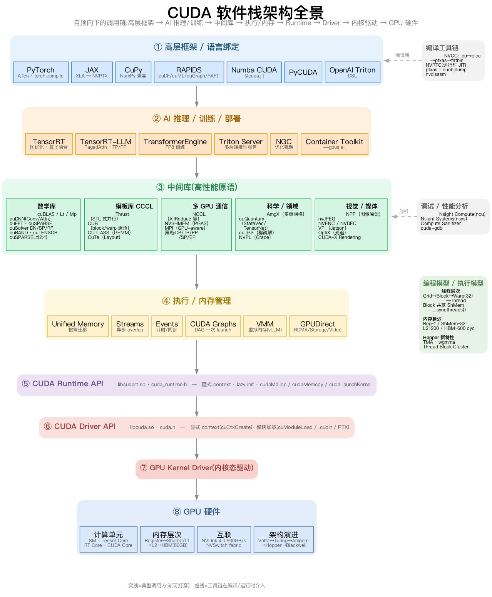
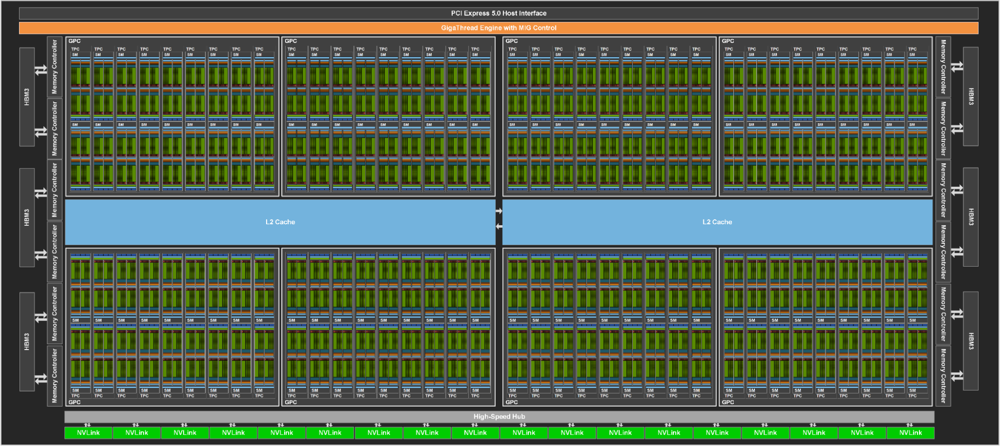
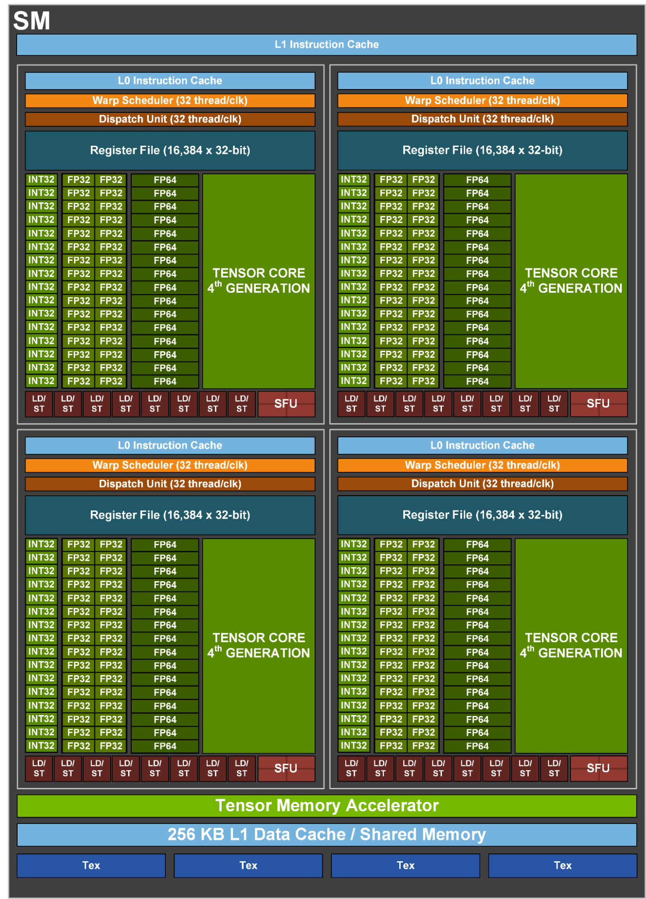
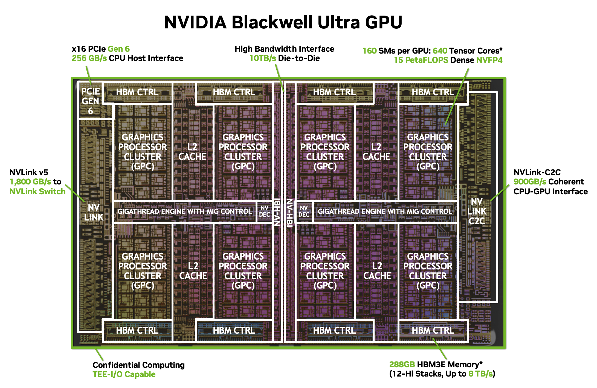
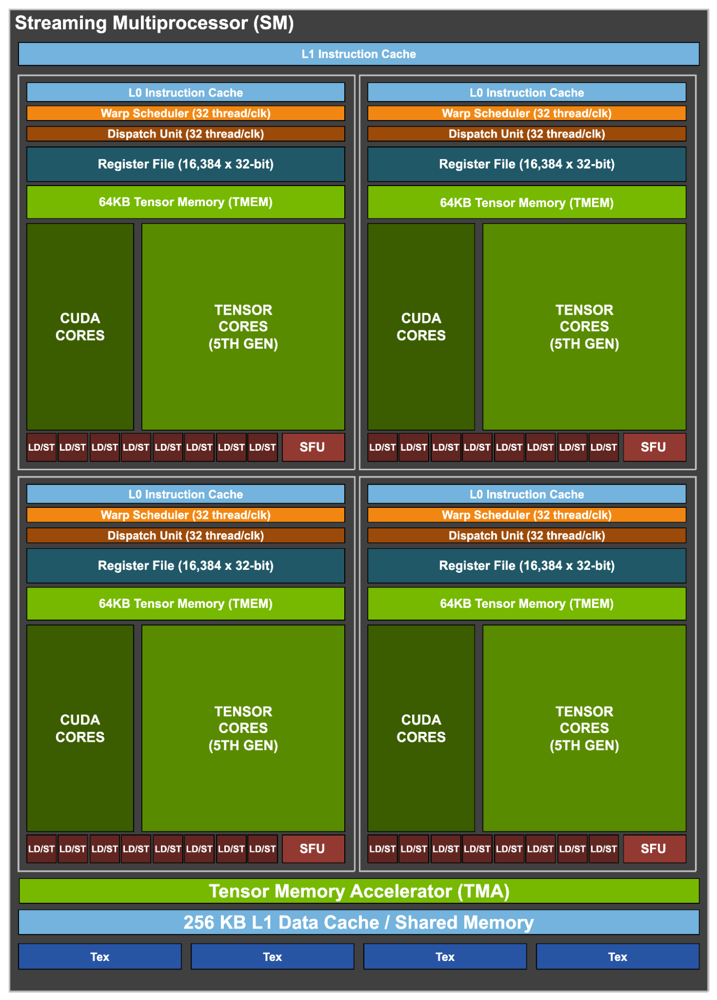

> 本文是[国产 AI 芯片生态全景:SDK、框架适配与开发者社区指南]()的 CUDA 部分展开。总文给出各家芯片的横向速查,本文专注把 NVIDIA CUDA 生态逐模块讲透。

NVIDIA 的 CUDA 生态是当前 AI 训练与推理的事实基准,几乎所有国产 AI 芯片都以"兼容 CUDA 语义"为对齐目标。这篇文章把整个生态按层级拆开,逐个模块讲清楚职责、定位与典型用法,帮开发者建立一张完整的知识地图。

先用一张全景图概览整个软件栈的分层结构与自顶向下的调用链,后面各章再逐层展开:



## 生态总览导图

```
CUDA 生态
├── 底层基础     Driver API → PTX/SASS → NVVM IR
├── 编译工具     nvcc / NVRTC / ptxas / Nsight / Sanitizer
├── 内存管理     Streams/Events/Graphs/VMM/GPUDirect
├── 数学库       cuBLAS(Lt) / cuDNN / cuFFT / cuSPARSE / cuSolver / cuTENSOR
├── 模板库       Thrust / CUB / CUTLASS / CuTe
├── AI 推理      TensorRT / TensorRT-LLM / TransformerEngine / Triton Server
├── 多 GPU 通信  NCCL / NVSHMEM / NVLink / GPUDirect RDMA
├── 科学计算     AmgX / cuQuantum / cuDSS / NVPL
├── 视觉媒体     NPP / nvJPEG / NVENC/NVDEC / VPI / OptiX
├── 语言绑定     PyCUDA / Numba / CuPy / Triton DSL
├── 数据科学     RAPIDS (cuDF/cuML/cuGraph/RAFT)
└── 部署         NGC / Container Toolkit / Triton Server
```

这个生态的核心设计哲学是**分层**:底层硬件特性通过 Driver/Runtime 暴露,数学库在其上提供高性能原语,框架再在数学库之上构建算子,最终用户通过 PyTorch/JAX 等高层 API 使用。每层都可以单独"打穿"——需要极致性能时可从 PyTorch 一路下探到 CUTLASS 甚至手写 SASS。下文即按这张导图自底向上逐层展开。

## 硬件架构基础

整个软件栈最终都落到 GPU 硬件上,因此先把 NVIDIA 架构演进与近两代官方架构图放在最前面作为对照基准(国产芯片也几乎都以"对齐 CUDA 语义"为目标)。

| 架构 | 代表产品 | 关键 CUDA 特性 |
|------|---------|--------------|
| Volta (sm_70) | V100 | Tensor Core 1.0(FP16)、Independent Thread Scheduling |
| Turing (sm_75) | T4/RTX 20xx | INT8/INT4 Tensor Core、RT Core、TF32 |
| Ampere (sm_80/86) | A100/RTX 30xx | TF32/BF16 Tensor Core、A100 结构化稀疏、MIG、NVLink 3.0 |
| Hopper (sm_90) | H100/H800 | FP8 Tensor Core、TMA、wgmma、Thread Block Cluster、NVLink 4.0 |
| Blackwell (sm_100) | B100/B200 | FP4 Tensor Core、第五代 NVLink、NVLink Switch System |

### 官方架构图

**Hopper(H100 / GH100,2022)**



> 图:GH100 完整芯片框图(满配 144 个 SM)。顶部 PCIe 5.0 主机接口 + GigaThread 引擎,8 个 GPC(图形处理簇)环绕中央 L2 Cache,两侧为 HBM3 显存控制器,底部 High-Speed Hub 接 18 条 NVLink。来源:NVIDIA 官方博客 [NVIDIA Hopper Architecture In-Depth](https://developer.nvidia.com/blog/nvidia-hopper-architecture-in-depth/)。



> 图:H100 的 SM(流多处理器)内部结构。4 个处理块各含 Warp Scheduler/Dispatch、16K×32bit 寄存器文件、INT32/FP32/FP64 CUDA 核与第四代 Tensor Core;底部是后文「编程模型核心概念」一节介绍的 **TMA(Tensor Memory Accelerator)** 与 256KB L1/Shared Memory。来源:同上 NVIDIA 官方博客。

**Blackwell Ultra(B300 代,2025)**



> 图:Blackwell Ultra GPU 芯片框图。两颗 reticle 极限大小的 die 通过 10 TB/s 的 Die-to-Die 互联合成一颗逻辑 GPU,每侧多个 GPC + L2,外围 288GB HBM3E;左侧第五代 NVLink(1.8 TB/s),右侧 NVLink-C2C(900 GB/s 连 Grace CPU)。来源:NVIDIA 官方博客 [Inside NVIDIA Blackwell Ultra](https://developer.nvidia.com/blog/inside-nvidia-blackwell-ultra-the-chip-powering-the-ai-factory-era/)。



> 图:Blackwell Ultra 的 SM 结构。相比 H100,每个处理块新增 **64KB Tensor Memory(TMEM)**,Tensor Core 升级到第五代(支持 NVFP4)。来源:同上 NVIDIA 官方博客。

---

## 一、底层基础层

### 1. CUDA Driver API
最底层的接口,直接与 GPU 驱动交互。
- 显式管理 GPU context(`cuCtxCreate`)
- 加载 `.cubin`/PTX 模块(`cuModuleLoad`)
- 控制粒度最细,适合写底层运行时或推理引擎
- 对应头文件:`cuda.h`,链接库:`libcuda.so`

### 2. CUDA Runtime API
对 Driver API 的高级封装,是大多数开发者的入口。
- 隐式 context 管理,`cudaMalloc`/`cudaMemcpy`/`cudaLaunchKernel`
- 对应头文件:`cuda_runtime.h`,链接库:`libcudart.so`
- 提供 lazy initialization,首次 CUDA 调用时自动初始化

### 3. PTX(Parallel Thread Execution)
NVIDIA 定义的虚拟 ISA,介于 CUDA C++ 与机器码之间。
- 类似 LLVM IR,跨 GPU 架构可移植
- 可用 NVRTC 在运行时从 PTX JIT 编译为 SASS
- 是 `nvcc` 中间产物,也可手写嵌入 `.cu` 文件

### 4. SASS(Shader Assembly)
真正的 GPU 机器码,架构相关(sm_80/sm_90 等)。
- `cuobjdump --dump-sass` 可反汇编查看
- 调优极致性能时需阅读 SASS 确认 stall / bank conflict

### 5. NVVM IR
基于 LLVM IR 的中间表示,是 `libNVVM` 编译器后端的输入格式,供第三方编译器(如 MLIR、Julia、Numba)生成 GPU 代码使用。

---

## 二、编程模型核心概念

### 线程层次

```
Grid → Block → Warp(32 线程)→ Thread
```

- **Thread**:最小执行单元
- **Warp**:32 个 thread 的调度单位,同一 warp 内 SIMT 执行
- **Block**:共享 Shared Memory 和 `__syncthreads()`
- **Grid**:一次 kernel launch 的全部 blocks

### 内存层次

| 层级 | 访问范围 | 延迟 | 容量 |
|------|---------|------|------|
| Register | 单 thread | ~1 cycle | 有限(sm_90: 255/thread) |
| Shared Memory / L1 | Block 内 | ~32 cycle | 164KB/SM (H100) |
| L2 Cache | 全 GPU | ~200 cycle | 50MB (H100) |
| Global Memory (HBM) | 全 GPU | ~600 cycle | 80GB (H100 SXM) |
| Constant Memory | 全 GPU(只读) | 广播时=register | 64KB |
| Texture Memory | 全 GPU(只读,空间局部性缓存) | 同 L1 | — |

### 执行模型新特性(Hopper/H100)

- **TMA(Tensor Memory Accelerator)**:专用异步 bulk 数据搬运引擎,从 global → shared,无需 thread 参与地址计算
- **warpgroup MMA**:4 个 warp 协作完成 wgmma 指令,吞吐是 Ampere 的 2×
- **Thread Block Cluster**:多个 block 组成 cluster,共享 Distributed Shared Memory(DSMEM),跨 SM 低延迟通信

---

## 三、编译工具链

### 1. NVCC
NVIDIA 的 CUDA 编译器驱动,不是真正的编译器前端。
- 拆分 host 代码(转给 g++/clang)和 device 代码(转给 `cicc`/`ptxas`)
- 核心流程:`.cu` → `cicc`(NVVM IR)→ `ptxas`(SASS/cubin)→ fatbinary → 嵌入可执行文件
- 重要参数:`-arch=sm_90`(实体架构)、`-gencode`(多架构 fatbin)、`--ptxas-options=-v`(寄存器/shared mem 用量)

### 2. NVRTC(NVIDIA Runtime Compilation)
在运行时把 CUDA C++ 字符串编译为 PTX 或 cubin。
- TensorRT、Triton、JAX XLA 等框架的 JIT 编译依赖它
- 支持 C++17,可在运行时根据 shape/dtype 特化 kernel

### 3. ptxas
PTX → SASS 汇编器,`nvcc` 内部调用,也可独立使用。
- `--verbose` 输出寄存器数、shared mem 占用、spill 量

### 4. cuobjdump / nvdisasm
反汇编工具,查看 fatbin 内的 PTX 和 SASS。

### 5. Nsight 性能分析工具(ncu / nsys)
NVIDIA 的两款性能分析器,层级互补:nsys 先做系统级定位,ncu 再做单 kernel 下钻。

**ncu 与 nsys**

- Nsight Systems(nsys)—— 系统级时间线分析器
- CPU + GPU 时间线,CUDA stream、kernel、memcpy、NVTX range 全景,适合分析 CPU-GPU overlap 问题、stream 并发度、kernel 启动/通信瓶颈,开销低,可近实时采集整个应用
- 命令行:`nsys profile --trace=cuda,nvtx ./app`

- Nsight Compute(ncu)—— 逐 kernel 硬件性能分析器(替代旧版 nvprof)
- 采集 HW counter:SM occupancy、memory throughput、warp stall 分布、L1/L2 hit rate,Roofline 分析、Source Correlation(SASS ↔ 源码行),开销高,单 kernel 常需重放上百次
- 命令行:`ncu --set full -o profile.ncu-rep ./app`

**核心区别**

| 维度 | **nsys** (Nsight Systems) | **ncu** (Nsight Compute) |
|------|---------------------------|--------------------------|
| 定位 | 系统级 timeline 分析 | 单 kernel 微观分析 |
| 粒度 | 整个应用的时间线 | 单个 CUDA kernel 内部 |
| 关注点 | CPU/GPU 协同、调度、数据流 | SM 占用率、访存、指令、warp 效率 |
| 开销 | 低(可近实时采集) | 高(单 kernel 常需重放上百次) |
| 输出 | timeline (.nsys-rep) | kernel 指标报告 (.ncu-rep) |

**nsys 看什么(宏观)**

- kernel / memcpy / API 调用的时间线和先后关系
- CPU 和 GPU 之间的空隙(GPU 是否被喂饱、是否在等 CPU)
- H2D/D2H 拷贝与计算是否重叠、stream 并发情况
- NCCL 通信、CUDA API 阻塞、同步等待
- 回答"时间花在哪、瓶颈在哪个阶段"

**ncu 看什么(微观)**

- 单个 kernel 的 SM / 显存带宽利用率(Roofline)
- compute-bound 还是 memory-bound
- warp stall 原因、寄存器/shared memory 占用、occupancy
- 访存合并、L1/L2 命中率、指令吞吐
- 回答"这个 kernel 为什么慢、怎么优化"

**配合用法**:先用 nsys 跑全程找出耗时最多/调用最频繁的 kernel,再用 ncu 单独深挖那几个热点 kernel 定位具体瓶颈,避免一上来就对所有 kernel 做高开销的 ncu 采集。

#### nsys 输出字段说明

nsys 生成 `.nsys-rep`,常用 `nsys stats report.nsys-rep` 导出几张表。

**CUDA GPU Kernel Summary(`gpukernsum`)—— 看哪个 kernel 耗时:**

| 字段 | 含义 |
|------|------|
| `Time(%)` | 该 kernel 占 GPU 总时间百分比 —— **先看这列找热点** |
| `Total Time` | 累计耗时 |
| `Instances` / `Calls` | 调用次数 |
| `Avg / Med / Min / Max` | 单次耗时的均值/中位/极值(抖动大说明有 shape 不均或竞争) |
| `StdDev` | 耗时标准差 |
| `Name` | kernel 名(Triton 生成的名字带 `_kernel` 后缀) |

**CUDA API Summary(`cudaapisum`)—— 看 CPU 侧 API 开销:**
`cudaMalloc`、`cudaMemcpyAsync`、`cudaLaunchKernel` 等每个 API 的总耗时/次数。`cudaLaunchKernel` 占比高 = kernel 启动太频繁(融合不够);`cudaMalloc` 频繁 = 没用显存池。

**Memory Operation Summary(`gpumemtimesum` / `gpumemsizesum`):**
`[CUDA memcpy HtoD]` / `[DtoH]` / `[DtoD]` 的耗时和字节数。H2D/D2H 占比高 = CPU-GPU 数据搬运是瓶颈。

**判读逻辑**:GPU Kernel 总时间 ÷ 墙钟时间 = GPU 利用率。利用率低但 API/memcpy 高 → GPU 在等 CPU 喂数据,不是算力瓶颈。

#### ncu 输出字段说明

ncu 生成 `.ncu-rep`,核心是几个 section。

**GPU Speed Of Light(SOL)—— 最该先看的总览:**

| 字段 | 含义 |
|------|------|
| `Compute (SM) Throughput [%]` | SM 计算单元利用率 |
| `Memory Throughput [%]` | 显存带宽利用率 |
| `DRAM Throughput [%]` | 对 HBM 的实际带宽占比 |
| `Duration` | 本 kernel 执行时间 |
| `Achieved Occupancy` | 实际达到的 occupancy |

判读:Memory% 远高于 Compute% → **memory-bound**(优化访存/融合);反之 **compute-bound**(优化指令/用 Tensor Core);两个都低 → 延迟瓶颈(occupancy 或 stall 问题)。

**Launch / Occupancy Statistics:**

| 字段 | 含义 |
|------|------|
| `Grid Size` / `Block Size` | 启动配置 |
| `Registers Per Thread` | 每线程寄存器数 —— 太高会限制 occupancy |
| `Shared Memory Per Block` | 每 block 共享内存用量 |
| `Theoretical / Achieved Occupancy [%]` | 理论 vs 实际活跃 warp 占比;差距大说明负载不均或尾部效应 |
| `Waves Per SM` | 波数,<1 说明 SM 没喂满(grid 太小) |

**Memory Workload Analysis:**

| 字段 | 含义 |
|------|------|
| `L1/TEX Cache Hit Rate` / `L2 Hit Rate` | 缓存命中率 |
| `Memory Throughput [GB/s]` | 实际访存带宽 |
| `Global Load/Store` 的 `Sectors/Req` | 每次请求的 sector 数 —— **反映访存是否合并**,理想值小,大说明 stride 布局导致非合并访存 |

**Scheduler / Warp State Statistics(找 stall 原因):**

| 字段 | 含义 |
|------|------|
| `Warp Cycles Per Issued Instruction` | 每发射指令平均等待周期 |
| `Stall [原因]` | warp 停顿原因分布:`Long Scoreboard`(等显存,memory-bound 信号)、`Barrier`(等同步)、`MIO Throttle`、`Not Selected` |
| `Issued Warp Per Scheduler` | 调度器每周期发射的 warp 数 |

**Compute Workload Analysis:**
`Executed IPC`(每周期指令数)、各 pipe(FMA/ALU/Tensor)利用率。Tensor pipe 高 = 在用 Tensor Core。

**判读路线:**
1. 先看 SOL 判 compute-bound 还是 memory-bound
2. memory-bound → 查 L2 命中率 + `Sectors/Req`(访存是否合并)
3. compute-bound → 查 IPC + Tensor pipe 利用率
4. 两个都低 → 查 Occupancy + Warp Stall 原因(通常是 `Long Scoreboard` 等显存,或寄存器溢出限制 occupancy)

### 6. Compute Sanitizer(原 cuda-memcheck)
运行时错误检测套件:
- `memcheck`:越界/未初始化内存访问
- `racecheck`:Shared Memory race condition
- `synccheck`:`__syncthreads()` 死锁检测
- `initcheck`:全局内存未初始化读取

### 7. cuda-gdb
GPU 调试器,支持在 device kernel 内设断点、查看寄存器/shared mem。

---

## 四、核心数学库

### 1. cuBLAS
稠密线性代数,BLAS Level 1/2/3。
- `cublasSgemm`:单精度矩阵乘,底层调 Tensor Core
- **cuBLASLt**:轻量级版本,支持自定义 epilogue(如 bias+ReLU 融合)、混合精度(FP8 on H100)
- **cuBLASMp**:多 GPU/多节点 BLAS,基于 NCCL+cuBLAS

### 2. cuDNN
深度学习算子库,最核心的 AI 基础库。
- Conv(前向/反向)、Pooling、BatchNorm、LayerNorm、Softmax、Attention
- **cuDNN Flash Attention**:从 v8.9 起支持 MHA fused kernel(FlashAttention-2 风格)
- Graph API(v8+):描述算子图,让 cuDNN 自动融合和选 algo
- 支持 FP32/TF32/FP16/BF16/INT8/FP8(Hopper)

### 3. cuFFT
快速傅里叶变换。
- 1D/2D/3D,实数/复数,单/双精度
- `cufftPlanMany` 支持批量 FFT(信号处理、科学计算)
- **cuFFTMp**:多 GPU 分布式 FFT

### 4. cuSPARSE
稀疏矩阵运算。
- SpMM(稀疏×稠密)、SpGEMM(稀疏×稀疏)、SpSV(稀疏三角求解)
- 支持 CSR/CSC/COO/BSR 格式
- Ampere 起支持结构化稀疏(2:4 sparsity)加速

### 5. cuSolver
线性代数求解器,分三个子库:
- **cuSolverDN**:稠密矩阵(LU/QR/SVD/Cholesky)
- **cuSolverSP**:稀疏直接解法(基于 cuSPARSE)
- **cuSolverRF**:稀疏矩阵重因子化(适合同一稀疏结构多次求解)

### 6. cuRAND
随机数生成。
- XORWOW、MRG32k3a、Philox、MTGP32 等多种 RNG
- Host API(CPU 控制)+ Device API(kernel 内直接生成)

### 7. cuTENSOR
通用张量收缩库(爱因斯坦求和)。
- `cutensorContraction`:任意维度张量收缩,自动利用 Tensor Core
- 比手写 cuBLAS reshape 更优雅,TensorFlow/PyTorch 后端有使用
- **cuTENSORMg**:多 GPU 版本

### 8. cuSPARSELt
结构化稀疏(2:4 sparsity)专用加速库,Ampere/Hopper 上 SpMM 吞吐是稠密的 2×。

---

## 五、高性能模板库

### 1. Thrust
类似 C++ STL 的并行算法库。
- `thrust::sort`、`thrust::reduce`、`thrust::transform`、`thrust::scan`
- 后端可切换(CUDA/TBB/OpenMP),与 STL 无缝互操作
- 现随 CCCL(CUDA Core Compute Libraries)维护

### 2. CUB(CUDA UnBound)
Block/Warp/Device 级别的 collective primitives,是 Thrust 的底层。
- `cub::BlockReduce`、`cub::WarpScan`、`cub::DeviceRadixSort`
- 高性能 kernel 开发者直接用 CUB,比自己写 reduction 快且正确
- 现随 CCCL 维护(GitHub: nvidia/cccl)

### 3. CUTLASS(CUDA Templates for Linear Algebra Subroutines)
GEMM 的模板化实现,可定制 epilogue、tile size、数据类型。
- 覆盖 Volta/Turing/Ampere/Hopper 所有 Tensor Core 变体
- **CUTLASS 3.x**:引入 CuTe(Cute Tensor)抽象,用 `Layout`/`Tensor` 描述 tiling,大幅简化 Hopper TMA + wgmma 编程
- TensorRT、vLLM、FlashAttention 等都在 CUTLASS 之上构建
- GitHub: NVIDIA/cutlass

### 4. CuTe(CUTLASS 3.x 子库)
描述 tensor layout 和 tiling 的元编程框架,不是独立库,是 CUTLASS 3.x 的核心抽象层。可单独 include 用于自定义 kernel。

---

## 六、AI / 推理生态

### 1. TensorRT
NVIDIA 的推理优化引擎。
- 解析 ONNX/TF/PyTorch 模型 → 图优化(算子融合、常量折叠)→ 生成优化后的引擎文件
- 自动选 kernel(cuBLASLt algo / cuDNN algo / 自定义 plugin)
- 支持 FP32/FP16/INT8/FP8 量化,Sparsity 加速
- **TensorRT-LLM**:专为 LLM 推理设计,内置 PagedAttention、TP/PP 并行、inflight batching

### 2. cuDNN(已在数学库中提及)
AI 框架(PyTorch/TF/JAX)的算子底层。

### 3. NCCL(NVIDIA Collective Communications Library)
多 GPU / 多节点集合通信。
- AllReduce、AllGather、ReduceScatter、Broadcast、Send/Recv
- 自动选通信路径:NVLink(机内)> NVSwitch(NVLink fabric)> InfiniBand RDMA > PCIe
- DDP(PyTorch DistributedDataParallel)、Megatron-LM、DeepSpeed 的通信底层

### 4. NVSHMEM
基于 OpenSHMEM 的 GPU 间 PGAS(分区全局地址空间)通信。
- 允许 device kernel 直接 `nvshmem_put`/`nvshmem_get` 到其他 GPU 内存
- 适合细粒度、不规则的 GPU-to-GPU 通信模式(如稀疏通信)

### 5. Triton Inference Server(Triton)
生产级模型推理服务框架。
- 支持 TensorRT、ONNX Runtime、PyTorch TorchScript、TF SavedModel 等多后端
- gRPC/HTTP 接口,动态 batching,模型集成(ensemble)
- 配套 Perf Analyzer 做性能基准测试

### 6. TransformerEngine
针对 Transformer 的混合精度训练库(FP8 on Hopper)。
- 提供 `te.Linear`、`te.LayerNorm`、`te.MultiheadAttention` 等 FP8 感知模块
- 与 Megatron-LM、NeMo 深度集成

---

## 七、科学计算 & 领域库

### 1. AmgX
代数多重网格求解器,用于 CFD/FEA 中大规模稀疏线性系统。
- OpenFOAM、ANSYS Fluent 等 CFD 软件的 GPU 加速后端

### 2. cuQuantum
量子计算模拟加速库,两个子组件:
- **cuStateVec**:状态向量模拟(全振幅量子电路模拟)
- **cuTensorNet**:张量网络收缩(适合更大量子比特数,近似模拟)
- Qiskit Aer、PennyLane GPU 后端基于此

### 3. HPC-X / OpenMPI GPU-Aware
MPI 实现,支持 GPU buffer 直接作为 MPI send/recv 缓冲区(需 GPUDirect RDMA)。

### 4. NVPL(NVIDIA Performance Libraries)
针对 Grace(ARM)CPU 的性能库套件,包含 BLAS/LAPACK/FFT/SPARSE,与 CUDA 生态配合用于 Grace-Hopper 超级芯片。

### 5. cuDSS(CUDA Direct Sparse Solver)
直接稀疏求解器,2023 年推出,补充 cuSolver 在大规模稀疏直接法上的能力。

---

## 八、图像 / 视觉 / 媒体

### 1. NPP(NVIDIA Performance Primitives)
图像处理原语库。
- 色彩空间转换、几何变换、滤波、形态学操作、统计
- 对标 OpenCV,但更底层、性能更高

### 2. nvJPEG / nvJPEG2000
JPEG/JPEG2000 的 GPU 加速编解码。
- 训练数据 pipeline 的解码瓶颈常用此优化

### 3. Video Codec SDK(NVENC / NVDEC)
硬件视频编解码。
- NVENC:H.264/HEVC/AV1 编码(专用硬件引擎,不占 CUDA core)
- NVDEC:解码,支持 4K/8K
- FFmpeg GPU 加速后端基于此

### 4. VPI(Vision Programming Interface)
计算机视觉算法库,统一 CPU/GPU/NVDLA 后端。
- 多目标追踪、光流(TVL1/Farneback)、特征检测、stereo disparity
- 主要面向 Jetson 嵌入式平台

### 5. OptiX
光线追踪 SDK。
- 基于 NVIDIA RT Core(Turing+)的 BVH 加速光线遍历
- 用于离线渲染(Blender Cycles GPU)、科学可视化

### 6. CUDA-X Rendering(EGL / OpenGL / Vulkan 互操作)
CUDA 与图形 API 的 interop,共享 GPU buffer,零拷贝。

---

## 九、内存管理进阶

### 1. Unified Memory(统一内存)
`cudaMallocManaged` 分配,CPU 和 GPU 共享同一虚拟地址空间。
- 按需迁移(page fault 驱动),开发方便但性能不可预测
- Hopper 上支持 `cudaMemAdvise` 预取策略优化

### 2. CUDA Streams
异步执行队列,实现 kernel + memcpy overlap。
- `cudaStreamCreate`、`cudaStreamSynchronize`
- 多 stream 并发执行需满足依赖无关性

### 3. CUDA Events
精确 GPU 计时和 stream 间同步点。
- `cudaEventRecord` / `cudaEventSynchronize` / `cudaEventElapsedTime`

### 4. CUDA Graphs
将一系列 kernel 和 memcpy 记录为 DAG,一次性 launch,消除 CPU launch overhead。
- 对小 kernel 密集型工作负载(如 LLM decode 阶段)提升显著
- PyTorch `torch.cuda.CUDAGraph` 封装此功能

### 5. VMM(Virtual Memory Management)
细粒度虚拟内存管理 API(CUDA 10.2+)。
- `cuMemCreate` / `cuMemMap`:物理内存分配与虚拟地址映射分离
- PagedAttention(vLLM)的 GPU KV Cache 内存管理基于此实现

### 6. GPUDirect 技术家族
- **GPUDirect RDMA**:网卡/InfiniBand 直接与 GPU 内存交换数据,绕过 CPU
- **GPUDirect Storage(GDS)**:NVMe SSD 直接 DMA 到 GPU 内存(`cuFile` API)
- **GPUDirect Video**:视频帧捕获设备直接送入 GPU

---

## 十、多 GPU / 多节点并行

### 1. NVLink & NVSwitch
GPU 间高带宽互联。
- NVLink 4.0(Hopper):单向 900 GB/s(双向 1.8 TB/s,8 卡 NVSwitch fabric)
- NVSwitch:机箱内全互联交换芯片,所有 GPU 以全带宽通信

### 2. NCCL(已在 AI 生态提及)

### 3. MPI + NVSHMEM(已提及)

### 4. 并行策略(框架层)
- **Data Parallelism**:DDP(PyTorch),每卡完整模型,AllReduce 梯度
- **Tensor Parallelism**:Megatron-LM,矩阵按列/行分割到多卡
- **Pipeline Parallelism**:模型按层切分,micro-batch 流水
- **Sequence Parallelism**:序列维度切分(DeepSpeed Ulysses / Ring Attention)
- **Expert Parallelism**:MoE 模型的 expert 分布到多卡

---

## 十一、语言绑定 & 高层框架

### 1. PyCUDA
Python 直接操作 CUDA,`pycuda.driver` 对应 Driver API,`pycuda.compiler` 包装 NVRTC。

### 2. Numba CUDA
Python JIT 编译器,用 `@cuda.jit` 装饰器写 GPU kernel,底层生成 PTX。

### 3. CuPy
NumPy 兼容的 GPU 数组库,底层调 cuBLAS/cuFFT/cuSPARSE。
- `import cupy as cp`,API 几乎与 NumPy 一致

### 4. PyTorch
最主流的深度学习框架,CUDA 集成最深。
- ATen 算子库 → 调 cuBLAS/cuDNN/CUTLASS
- `torch.compile`(TorchDynamo + TorchInductor):Python 代码 → Triton kernel JIT
- `torch.distributed`:封装 NCCL

### 5. JAX
Google 的函数式 ML 框架,XLA 编译器后端,CUDA 支持通过 XLA+NVPTX。

### 6. OpenAI Triton(非 Triton Inference Server)
Python DSL,编写高效 GPU kernel,自动处理 tiling/vectorization。
- 比 CUDA C++ 开发更快,性能接近手写 CUTLASS
- PyTorch Inductor 生成 Triton kernel

Triton 介于 PyTorch(太高层,难控制)和 CUDA C++(太底层,开发慢)之间。关键差异:CUDA 要你管理**单个 thread**,Triton 让你管理 **block(一组数据)**,thread 内部的调度、访存合并、shared memory 分配交给编译器自动做。

| 方案 | 开发成本 | 性能 | 控制粒度 |
|------|---------|------|---------|
| PyTorch 算子组合 | 低 | 一般(kernel 启动多、访存冗余) | 低 |
| CUDA C++ | 高(要管线程/shared mem/同步) | 高 | 全部手动 |
| **Triton** | 中 | 接近手写 CUDA | block 级 |

**算子实例:`fused_add_rms_norm`(残差加 + RMSNorm 融合)**

这是 vLLM 里最常见的融合模式:本来「残差相加」+「RMSNorm」两步、两个 kernel、两趟显存读写,融合成一个 kernel 一趟搞定。基础的 whole-row kernel(一行一个 program):

```python
@libentry()
@triton.jit(do_not_specialize=["eps"])
def fused_add_rms_norm_kernel(
    input_ptr, residual_ptr, w_ptr,
    in_stride_r, in_stride_c, r_stride_r, r_stride_c,
    N, eps, BLOCK_SIZE: tl.constexpr,
):
    pid = ext.program_id(0)                  # 我是第几行
    input_ptr    += pid * in_stride_r        # 指针移到这一行
    residual_ptr += pid * r_stride_r

    cols = tl.arange(0, BLOCK_SIZE)          # 这一行的列 [0..BLOCK_SIZE)
    mask = cols < N                          # 边界保护(N 不一定是 2 的幂)

    x        = tl.load(input_ptr    + cols*in_stride_c, mask=mask, other=0.0).to(tl.float32)
    residual = tl.load(residual_ptr + cols*r_stride_c, mask=mask, other=0.0).to(tl.float32)

    added = x + residual                     # ① 残差相加
    tl.store(residual_ptr + cols*r_stride_c, added, mask=mask)   # residual 原地写回

    sum_sq   = tl.sum(added*added, axis=0)   # ② 行内归约求平方和
    variance = sum_sq / N
    rrms     = 1.0 / tl.sqrt(variance + eps) # RMS 的倒数

    weight = tl.load(w_ptr + cols, mask=mask, other=0.0)
    output = (added * rrms * weight).to(compute_dtype)          # ③ 归一化 * 权重
    tl.store(input_ptr + cols*in_stride_c, output, mask=mask)   # input 原地写回
```

对应 Triton 编程模型要点:

| 代码 | 含义 |
|------|------|
| `program_id(0)` + `grid=(M,)` | 启动 M 个 program,每个负责张量的**一整行**(一个 token 的 hidden_dim)。block 级思维:不管 thread,只管「这一块数据」 |
| `cols = tl.arange(0, BLOCK_SIZE)` | 对**整行向量**一次性操作,编译器负责拆成 thread 做访存合并 |
| `mask = cols < N` | 用 mask 代替 `if` 处理边界,`BLOCK_SIZE = next_power_of_2(N)` 可能比 N 大 |
| `.to(tl.float32)` | fp16/bf16 输入**升到 fp32 累加**,避免归约精度损失,最后再降回去 |
| `tl.sum(..., axis=0)` | 行内归约,Triton 自动用 shared memory + warp shuffle 实现 |
| 两次 `tl.store` 原地写 | 融合的价值:`added` 算一次,既写回 residual 又喂给归一化,省掉中间 tensor 和一趟显存往返 |

**一个算子三个 kernel —— host dispatch 是关键**

同一个算子文件里有**三份 kernel**,host 函数按 shape 选最快的:

| kernel | 适用 shape | 为什么 |
|--------|-----------|--------|
| **whole-row** | 普通中小 N(N ≤ 16384) | 一行一 program,整行放进寄存器,最简单最快 |
| **2D persistent** | N≤128 且 M≥262144(短行、超多行) | 行太短太多,一行一 program 会启动几百万个 program 开销爆炸。改成固定 4096 个常驻 program,每个循环吃多行(`BLOCK_M=4`),一次归约 4 行 |
| **tiled 两趟** | 超大 N(>32768) | 一行放不进寄存器/shared mem,分块:第一趟累加平方和,第二趟再读一遍做归一化 |

```python
def fused_add_rms_norm(x, residual, normalized_shape, weight, eps=1e-5):
    M = math.prod(x.shape[:dim])    # 行数
    N = math.prod(normalized_shape) # 行宽
    x = x.contiguous(); residual = residual.contiguous()  # 规整 layout
    if _prefer_2d_persistent(M, N):  ...  # 按 shape 路由到三条路径之一
    elif _prefer_whole_row(x, M, N): ...
    else:                            ...  # tiled
    return x, residual
```

生产级 Triton 算子的真实样子:kernel 只是计算核,**host 的 shape 路由 + autotune 才决定性能**。单个 `@triton.jit` 好写,难的是针对不同 shape 维持高性能。FlashAttention、FlagGems、PyTorch Inductor 生成的 kernel 都是这个范式。

### 7. Triton 算子如何派发到 vLLM(以 FlagGems-vllm / vllm-plugin-fl 为例)

Triton 写的算子库要接入推理框架,vLLM 的调用链是:

```
vLLM  →  vllm-plugin-fl  →  flag_gems.enable()  +  flaggems_vllm.<op>()
```

派发分两条完全不同的路。

**路径 A:通用算子 —— 劫持 PyTorch dispatch(`flag_gems.enable()`)**

「偷梁换柱」式派发,模型代码一行不用改。

1. **vLLM 加载插件**:启动时扫描 entry points 组 `vllm.general_plugins`。插件在 `pyproject.toml` 注册入口,vLLM 调 `load_general_plugins()` 时执行插件注册函数。`VLLM_PLUGINS=fl` 控制只加载哪个插件。
2. **插件调 `enable()` 注册到 aten 库**:把算子注册进 `torch.library.Library("aten", "IMPL")`,核心一句 `lib.impl(key, fn, "CUDA")` —— 把 `aten::<op>` 在 CUDA dispatch key 上的实现替换成 Triton 实现。之后模型里 `torch.rms_norm` / `torch.matmul` 等调用被 PyTorch dispatcher 自动路由到 Triton kernel,调用方无感知。
3. **按设备/vendor 过滤**:用 `DeviceDetector` 拿 `dispatch_key`,非 NVIDIA vendor 剔掉本芯片没实现的算子;支持 `only_enable(include=[...])` 白名单和 `exclude` 黑名单。

**路径 B:vLLM 专用融合算子 —— 直接调用 / CustomOp**

像 `fused_add_rms_norm`、`fused_experts_impl`、`grouped_topk` 这种大融合 kernel 不走 aten 劫持(PyTorch 没有对应 aten 算子),直接 import 函数替换:

```python
import flaggems_vllm
flaggems_vllm.fused_experts_impl(...)   # 插件/模型层显式调用
```

vLLM 侧用 **CustomOp 多后端分发**。每个算子是 `CustomOp` 子类,有 `forward_native`(torch 参考)、`forward_cuda`、`forward_oot`(out-of-tree,给第三方后端)等。`dispatch_forward` 按平台一次性选定实现:

```python
def dispatch_forward(self, compile_native):
    enabled = self._enforce_enable or self.enabled()
    if not enabled:
        return self.forward_native          # 回退到 torch 原生
    if current_platform.is_out_of_tree():
        return self.forward_oot             # 第三方后端走这里
    else:
        return self.forward_cuda
```

out-of-tree 插件通过 `register_oot` 把实现注册进 `op_registry_oot`;`enabled()` 查 `CompilationConfig` 的 `enabled_custom_ops`/`disabled_custom_ops` 决定是否启用。

**两条路对比**

| | 路径 A(通用算子) | 路径 B(vLLM 融合算子) |
|--|------|------|
| 机制 | `torch.library` 劫持 aten dispatch key | 直接函数调用 / CustomOp 后端选择 |
| 入口 | `flag_gems.enable()` / `flaggems_vllm.enable()` | `import flaggems_vllm; flaggems_vllm.<op>()` |
| 模型是否改代码 | 不改,PyTorch 自动路由 | 需显式调用或注册 CustomOp |
| 粒度 | 整库算子批量替换 | 单个高价值融合 kernel |
| 选择/过滤 | `include`/`exclude` YAML + vendor 过滤 | `VLLM_PLUGINS` + CompilationConfig 开关 |

一句话:通用算子靠劫持 PyTorch dispatch 无感替换;vLLM 专用融合 kernel 靠显式调用 + CustomOp 后端分发。vllm-plugin-fl 在 vLLM 启动时把这两条路都接上。

### 8. RAPIDS(cuDF / cuML / cuGraph)
GPU 加速数据科学套件。
- **cuDF**:GPU DataFrame(pandas 兼容)
- **cuML**:GPU 机器学习(sklearn 兼容,KMeans/DBSCAN/PCA 等)
- **cuGraph**:GPU 图分析(PageRank/BFS/社区检测)
- 底层大量使用 Thrust/CUB/RAFT

### 9. RAFT
Rapids 的基础机器学习原语库(ANN、距离计算、矩阵操作),供 cuML/cuVS 使用。

---

## 十二、容器 & 部署

### 1. NGC(NVIDIA GPU Cloud)
NVIDIA 官方容器镜像仓库(ngc.nvidia.com)。
- 提供预装 CUDA/cuDNN/TensorRT/PyTorch/TF 的优化容器
- 每月更新,是生产部署的推荐起点

### 2. NVIDIA Container Toolkit(nvidia-docker)
使容器内可访问 GPU,`--gpus all` 参数背后的实现。

### 3. Triton Inference Server(已提及)
